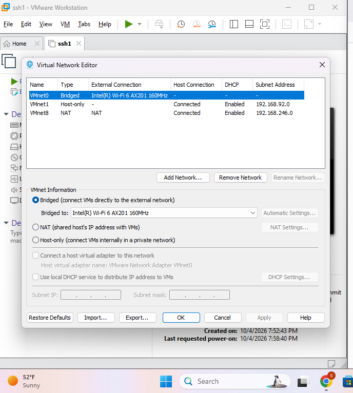
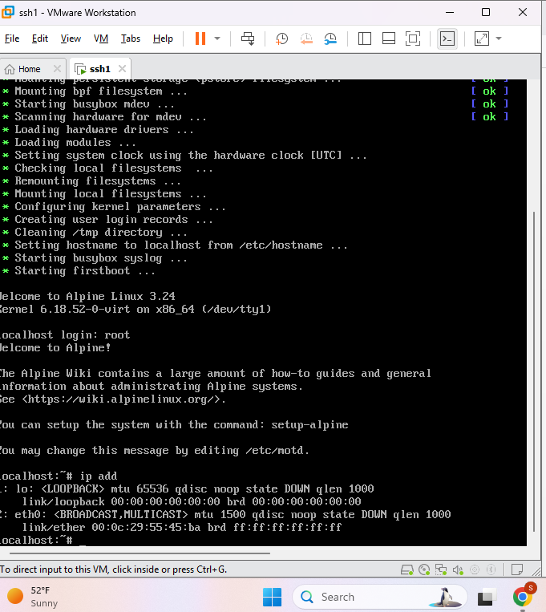
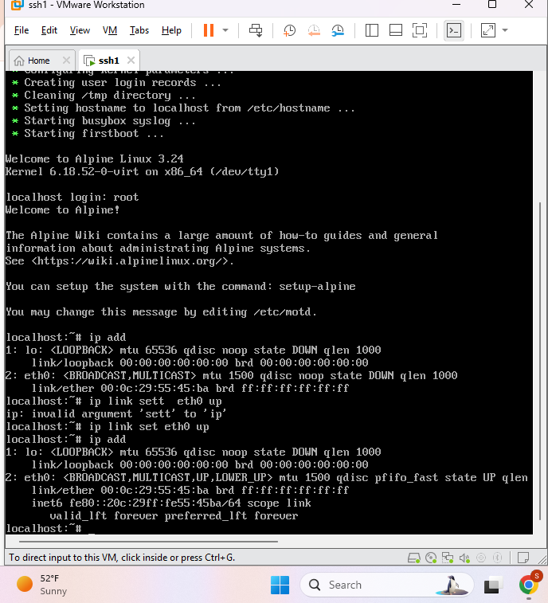
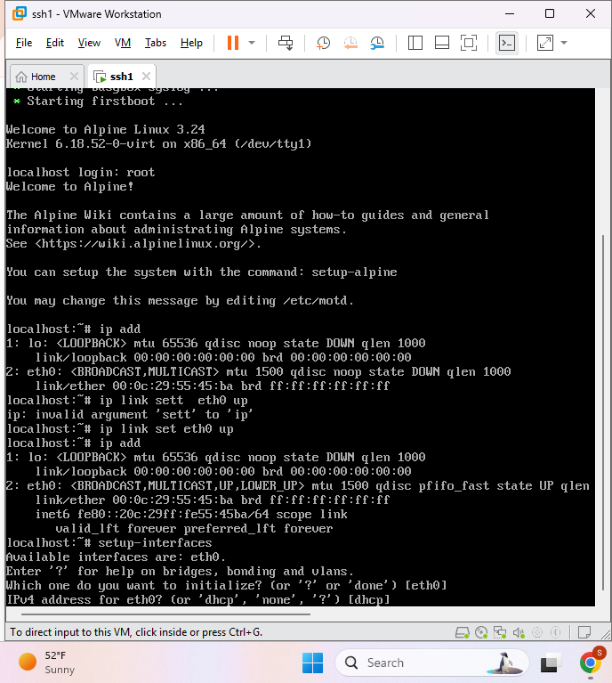
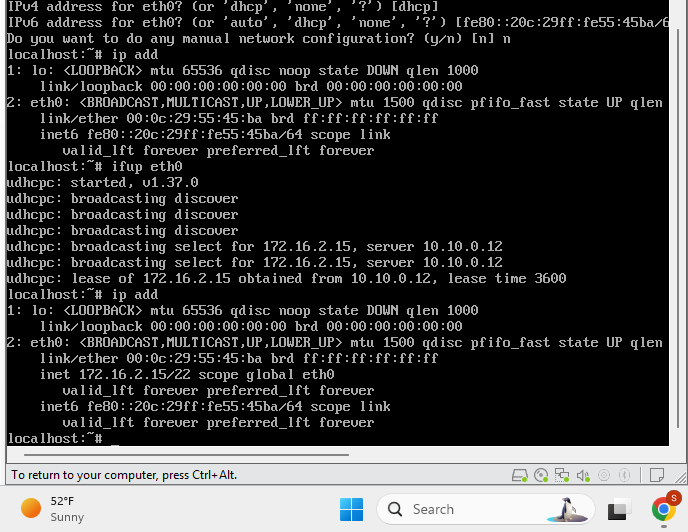
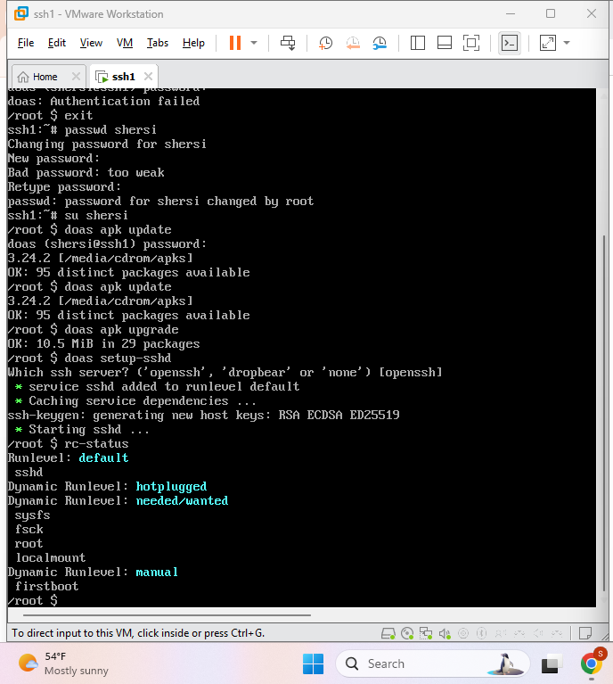
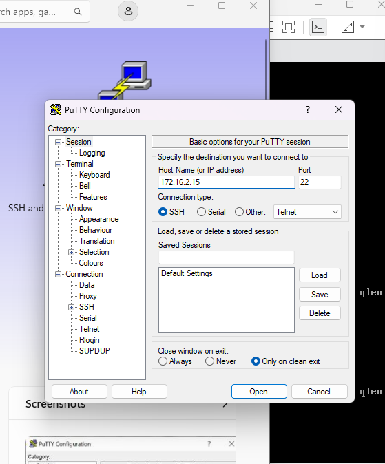
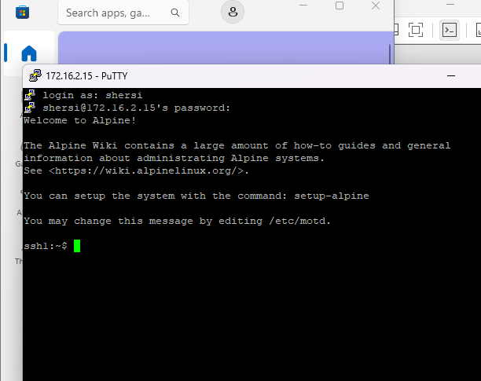

# Linux SSH Remote Administration Lab

## Overview
This hands-on lab demonstrates Linux system administration and secure remote access using Alpine Linux in VMware. I configured the virtual machine's network connectivity, obtained and verified an IPv4 address through DHCP, configured an OpenSSH server, and successfully connected remotely from Windows using PuTTY.

## Technologies Used
- Alpine Linux
- VMware Workstation
- OpenSSH / SSHD
- PuTTY
- Linux Command Line
- DHCP
- TCP/IP
- Bridged Networking

## Skills Demonstrated
- Linux system administration
- Virtual machine configuration
- Linux network configuration
- DHCP and IPv4 addressing
- Network interface configuration
- User account administration
- OpenSSH server configuration
- SSH remote administration
- Linux service management
- Command-line troubleshooting
- Remote connectivity verification

## Lab Process

### 1. Configure VMware Bridged Networking
Configured the VMware virtual network to use bridged networking, allowing the Alpine Linux virtual machine to communicate through the physical network connection.

### 2. Boot Alpine Linux
Started the Alpine Linux virtual machine in VMware and accessed the Linux command-line environment.

### 3. Configure the Network Interface
Enabled the `eth0` network interface and verified that the interface was operational.

### 4. Configure DHCP Networking
Configured the Linux network interface to obtain its IPv4 configuration dynamically through DHCP.

### 5. Verify IP Address
Verified the network configuration using Linux command-line tools. The virtual machine successfully obtained the IPv4 address `172.16.2.15`.

### 6. Configure OpenSSH
Configured the OpenSSH server, generated SSH host keys, started the SSH service, and verified the SSHD service status.

### 7. Configure PuTTY
Configured PuTTY on the Windows host to connect to the Alpine Linux system using SSH on port 22.

### 8. Establish Remote SSH Connection
Successfully authenticated to the Alpine Linux virtual machine remotely from Windows using PuTTY, confirming that the SSH server and network configuration were working correctly.

## Result
Successfully deployed an Alpine Linux virtual machine, configured network connectivity and OpenSSH, and established secure remote command-line access from a Windows workstation using PuTTY.

## Key Takeaways
This lab strengthened my practical experience with Linux administration, virtualization, TCP/IP networking, DHCP, SSH, remote system administration, service configuration, and troubleshooting.
